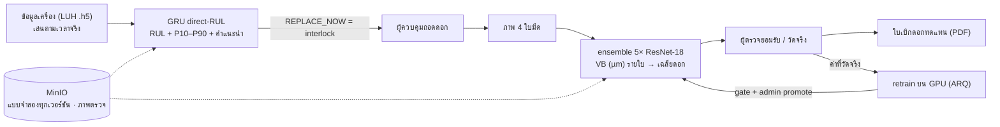

# 🏭 CNC Tool Life AI — Predictive Maintenance ของดอกกัด

> พยากรณ์ **อายุใช้งานที่เหลือ (RUL)** ของดอกกัด CNC จากข้อมูลที่เครื่องบันทึกเองทุกแนวตัด (time series) แล้ว **วัดรอยสึกด้านข้าง VB จากภาพใบมีด** ตอนถอดดอก (non-time-series)
> ทั้งสองแบบจำลองใช้เกณฑ์เดียวกัน: VB ≥ **140 µm** = หมดอายุ (เกณฑ์เฉพาะงาน — ISO 8688-2 ให้ตั้งเกณฑ์ล่วงหน้า) · **103 µm** = เริ่มสึกเร่ง/ใกล้หมดอายุ (จุดเปลี่ยนอัตราสึกที่พบในข้อมูล)



## 📌 สถานะปัจจุบัน

| เรื่อง | ค่า |
|---|---|
| แบบจำลอง RUL ที่ใช้งาน | **GRU direct-RUL** `tool-rul-gru-nomachine-1.0.0` — หน้าต่าง 29 แนวตัด × 9 อินพุต (เซนเซอร์ 7 + เวลาตัดสะสม + ตำแหน่งแนวตัด — ไม่ใช้ VB และไม่ใช้หมายเลขเครื่อง) |
| ผลของแบบจำลอง RUL (leave-one-tool-out 9 ดอก) — เกณฑ์หลัก: ใช้อายุดอกได้มากที่สุดโดยไม่เปลี่ยนช้าเกินเกณฑ์ | **ใช้อายุดอกได้ 92.0%** (ทุกดอก ≥ 85.6%) โดยเปลี่ยนช้าเกินเกณฑ์ **0/9 ดอก** — เทียบ fixed-life 82.0%, baseline อายุเฉลี่ยทุกดอก 81.1%, StateSpace 86.3% · ตัวชี้วัดประกอบ (ความแม่นของ RUL, นาทีของเวลาตัด): ช่วง 20% ท้ายที่ใช้ตัดสินใจ MAE 0.93 (baseline 8.33, StateSpace 2.65) และไม่พยากรณ์อายุเกินจริง > 1 ชั้นงาน (67%, 30%) · ทั้งอายุ 4.89 (12.71, 6.94) |
| ผลกับดอกที่ไม่เคยเห็น (T3/T6/T9) | ใช้อายุดอก **88–91%** · **เปลี่ยนช้าเกินเกณฑ์ 0/3 ดอก** · สั่งเปลี่ยนก่อนหมดอายุ 4.7–7.4 นาที · แจ้งวางแผนล่วงหน้า 10–13 นาที (MAE 2.16–4.81 นาที, ช่วง 20% ท้าย ≤ 1.3) |
| แบบจำลองวัด VB ที่ใช้งาน | **ensemble 5× ResNet-18** v2.0.0 ที่ retrain ในระบบด้วยค่าวัดจริง 24 ใบ (`tool-vision-vb-resnet18-20261007-135808`, อยู่ใน MinIO) · CV ดอก 1–7 MAE **19.6 µm** · ดอกทดสอบ 8–10 **24.5 µm** |
| ระบบ | 43 REST endpoint + 1 WebSocket · 9 หน้าเว็บ · 35 automated test · 7 container (+5 ของชุด observability) |

โค้ดการทดลองของแบบจำลองทั้งสองอยู่ในหัวข้อ [เอกสาร](#-เอกสาร)

## 🌟 ฟีเจอร์
1. **Tool Life Dashboard / Machine Monitoring** — RUL + ช่วง P10–P90, สถานะการสึก, คำแนะนำ (OK / WATCH / PLAN_REPLACEMENT / REPLACE_NOW), ETA, แผนเปลี่ยนดอก, drift ของอินพุต, สัญญาณสด — ข้อมูลจริงของดอก **T3/T6/T9 ที่ไม่เคยใช้ฝึก**
2. **Interlock** — REPLACE_NOW หยุดป้อนรอผู้ควบคุม (ถอดดอก / ตัดต่อ) · ทุกการตัดสินใจอยู่ใน Audit Trail · แจ้งเตือนจากผลจริง
3. **Tool Inspection** — ถอดดอกแล้วระบบถ่ายภาพ 4 ใบมีด → AI วัด VB + ช่วงความไม่แน่นอน → ระดับดอก = VB เฉลี่ย 4 ใบ (นิยามเดียวกับ label ของ RUL) → ผู้ตรวจยอมรับค่า AI หรือวัดจริงแล้วกรอกค่า → ใบเบิกดอกทดแทน (PDF) → รับจากคลัง → ติดตั้ง (เครื่องหยุดชั่วคราวรอกดเริ่มตัด)
4. **Retrain + Model Registry** — ค่าที่วัดจริงเท่านั้นเข้า pool → fine-tune บน GPU → gate → admin promote · ทุกเวอร์ชันของทั้งสองแบบจำลองอยู่ใน MinIO สลับกลับได้ (admin) · กราฟการเทรนในหน้าเว็บ + TensorBoard
5. **ไม่สปอยข้อมูล** — ระหว่างใช้งานไม่ส่ง VB / RUL จริง / ชื่อไฟล์ไปหน้าเว็บ · ค่าจริงเปิดเผยหลังถอดดอก (Reports) หรือทีละใบเมื่อผู้ตรวจเลือก "กรอกค่าที่วัด" ของใบนั้น
6. **Observability (ทางเลือก)** — OpenTelemetry → Prometheus / Tempo / Loki → Grafana

เครื่องเดียวกัน ดอกเดียวกัน: M1/M2/M3 = ข้อมูลเครื่อง LUH **T3/T6/T9** คู่กับภาพใบมีด Nonastreda **ดอก 8/9/10** (ไม่เคยใช้ฝึกทั้งคู่)

## 🏗️ โครงสร้าง (ทุกโฟลเดอร์มี README อธิบายไฟล์ข้างใน)
```
ai-ecosystem-Industrial-Predictive/
├── backend/                  FastAPI + แบบจำลองตอนใช้งาน                       → backend/README.md
│   ├── main.py               app, startup, รวม router ใต้ /api/v1
│   ├── app/features/         tool_life · tool_vision · reports · alarms · audit · auth · users · health · workers
│   ├── core/                 config · database · MinIO · Redis/ARQ · observability
│   ├── scripts/              อัปโหลดแบบจำลองขึ้น MinIO
│   └── tests/                pytest (35 test)
├── frontend/                 React 18 + TypeScript + Vite + Tailwind + Recharts  → frontend/src/README.md
├── timeseries_docs/tool_rul_forecast/   งาน time series: โค้ดการทดลอง, แบบจำลอง RUL
├── nontime_docs/tool_vb_vision/         งาน non-time-series: โค้ดการทดลอง stage A–D, แบบจำลองวัด VB
├── observability/            config ของ OTel Collector / Prometheus / Tempo / Loki / Grafana
├── docs/                     ดัชนีเอกสาร
├── dataset/                  LUH milling + Nonastreda (ไม่อยู่ใน git — ดู dataset/README.md)
├── logs/                     log ที่ container เขียน (postgres, redis, tensorboard ของ retrain) — ไม่อยู่ใน git
├── compose.yml               db, redis, minio, backend, trainer-worker (GPU), tensorboard, frontend
├── compose.observability.yml ชุดติดตามระบบ (ซ้อนกับ compose.yml)
├── API_SPECIFICATION.md      API ทั้งหมด (43 endpoint + WebSocket — ทุกตัวถูกใช้โดยหน้าเว็บ)
├── .env.example              ตัวอย่างค่าที่ต้องตั้ง (คัดลอกเป็น .env)
└── .gitignore · .gitattributes
```

### สิ่งที่ไม่อยู่ใน git (ต้องเตรียมเองถ้าจะรันระบบ)
| สิ่งที่ขาด | ขนาด | ได้มาอย่างไร |
|---|---|---|
| ชุดข้อมูล LUH milling + Nonastreda (`dataset/`) | ~10 GB + ~1.4 GB | ดาวน์โหลดจาก Mendeley Data แล้วแตกไฟล์ตาม [`dataset/README.md`](dataset/README.md) |
| น้ำหนักแบบจำลองวัด VB (`nontime_docs/tool_vb_vision/models/*.pt`) | ~214 MB | ฝึกด้วย `search_vb.py --final` ([`nontime_docs/tool_vb_vision/README.md`](nontime_docs/tool_vb_vision/README.md)) — ไฟล์ `.json` (ผลประเมิน + config) และค่าทายรายภาพอยู่ใน git |
| `.env`, log ของ container, TensorBoard `runs/` | – | สร้างเองตอนรัน (`.env` คัดลอกจาก `.env.example`) |
| งานรายวิชา: รายงาน, เอกสารสรุป, notebook, รูปและผลการทดลอง (csv/json) | – | ส่งแยก ไม่เกี่ยวกับการรันระบบ — ผลการทดลองสร้างใหม่ได้ด้วยสคริปต์ใน [`timeseries_docs/tool_rul_forecast/`](timeseries_docs/tool_rul_forecast/README.md) และ [`nontime_docs/tool_vb_vision/`](nontime_docs/tool_vb_vision/README.md) |

แบบจำลอง RUL (`.npz` ~110 KB) **อยู่ใน git** — อัปโหลดขึ้น MinIO ได้เลยโดยไม่ต้องฝึกใหม่

## 🔌 API (`/api/v1`) — รายละเอียดใน [API_SPECIFICATION.md](API_SPECIFICATION.md)
| Module | Endpoints |
|---|---|
| **Tool Life** | `GET /tool-life/fleet` · `GET /tool-life/machines/{m}` · `POST /tool-life/machines/{m}/{start\|pause\|resume\|reset\|speed\|acknowledge}` · `GET/POST /tool-life/model*` · `GET /tool-life/evaluations` · `WS /tool-life/stream` |
| **Tool Vision** | `GET /tool-vision/stations` · `POST …/stations/{m}/capture` · `GET …/inspections*` · `GET …/inspections/{id}/blades/{b}/measurement` · `POST …/inspections/{id}/review` · `…/requisitions*` · `GET …/stats` · `…/model*` · `…/training/*` |
| **Reports** · **Alarms** · **Audit** | `GET /reports/tool-life-summary` · `GET /reports/export/csv` · `/alarms*` · `GET /audit-logs` |
| **Auth** · **Users** · **Health** | `POST /auth/signup` · `POST /auth/login` · `GET /auth/me` · `/users*` (admin) · `GET /health` (Docker healthcheck) |

Swagger UI: http://localhost:8000/docs · snapshot ของ OpenAPI: [`backend/openapi.json`](backend/openapi.json)

## 🚀 Quickstart (Docker)
ต้องมี: Docker Desktop · ชุดข้อมูลใน `dataset/` · NVIDIA GPU + NVIDIA Container Toolkit สำหรับ `trainer-worker` (retrain) — ไม่มี GPU: เปิดเฉพาะบริการอื่นด้วย `docker compose up -d db redis minio backend tensorboard frontend` (งาน retrain จะรอในคิวจนกว่าจะมี trainer-worker)

```bash
cp .env.example .env                                   # ตั้ง JWT_SECRET_KEY เพื่อให้ล็อกอินค้างได้หลัง restart
docker compose up -d                                   # db, redis, minio, backend, trainer-worker (GPU), tensorboard, frontend
cd backend
uv run python scripts/publish_tool_rul_model.py --model-dir models/nomachine             # แบบจำลอง RUL → MinIO + ตั้งเป็น latest
uv run python scripts/publish_tool_vb_model.py --version tool-vision-vb-resnet18-2.0.0   # แบบจำลองวัด VB → MinIO (ต้องมี tool_vb_model.pt — ดูตารางด้านบน)
docker compose restart backend
```
- อัปโหลดแบบจำลองทำครั้งแรกครั้งเดียว (MinIO เก็บใน volume) · เครื่องเริ่มที่สถานะ `IDLE` รอผู้ควบคุมกดเริ่มตัด (`TOOL_LIFE_AUTOSTART=false`)
- เว็บ http://localhost:3000 (บัญชีตั้งต้นของเครื่องพัฒนา admin / engineer ถูกสร้างใน `backend/main.py` หรือสมัครใหม่ที่แท็บ Create Account) · MinIO Console http://localhost:9001 · TensorBoard http://localhost:6006
- Observability: `docker compose -f compose.yml -f compose.observability.yml up -d` → Grafana http://localhost:3001 ([observability/README.md](observability/README.md))

## 🧠 ฝึกแบบจำลองใหม่
| แบบจำลอง | วิธี |
|---|---|
| RUL (GRU) | [`timeseries_docs/tool_rul_forecast/README.md`](timeseries_docs/tool_rul_forecast/README.md): `experiments_rul.py` → `experiments_rul.py --nomachine` → `publish_tool_rul_model.py --model-dir models/nomachine` |
| วัด VB จากภาพ | ครั้งแรก/ค้นหาใหม่: [`nontime_docs/tool_vb_vision/README.md`](nontime_docs/tool_vb_vision/README.md) → `publish_tool_vb_model.py` · ระหว่างใช้งาน: **retrain อัตโนมัติ** เมื่อค่าวัดจริงจากดอกใหม่ครบ 6 ดอก (24 ภาพ) → admin promote / reject ในหน้า Tool Inspection |

## ✅ ทดสอบ
```bash
cd backend && uv run --no-sync pytest tests/ -q        # 35 test — เครื่องที่ไม่มี torch: 33 ผ่าน + 2 ข้าม
cd frontend && npx tsc --noEmit && npm run build
```
test ที่ต้องใช้ชุดข้อมูลจะข้ามเองถ้าไม่พบไฟล์ · รายละเอียด: [`backend/tests/README.md`](backend/tests/README.md)

## 📚 เอกสาร
- แบบจำลอง RUL (time series): [`timeseries_docs/tool_rul_forecast/`](timeseries_docs/tool_rul_forecast/README.md) — โค้ดการทดลองและแบบจำลองที่ใช้งาน
- แบบจำลองวัด VB จากภาพ (non-time-series): [`nontime_docs/tool_vb_vision/`](nontime_docs/tool_vb_vision/README.md) — โค้ดการทดลอง
- API: [`API_SPECIFICATION.md`](API_SPECIFICATION.md) · ดัชนีเอกสารทั้งหมด: [`docs/README.md`](docs/README.md)
